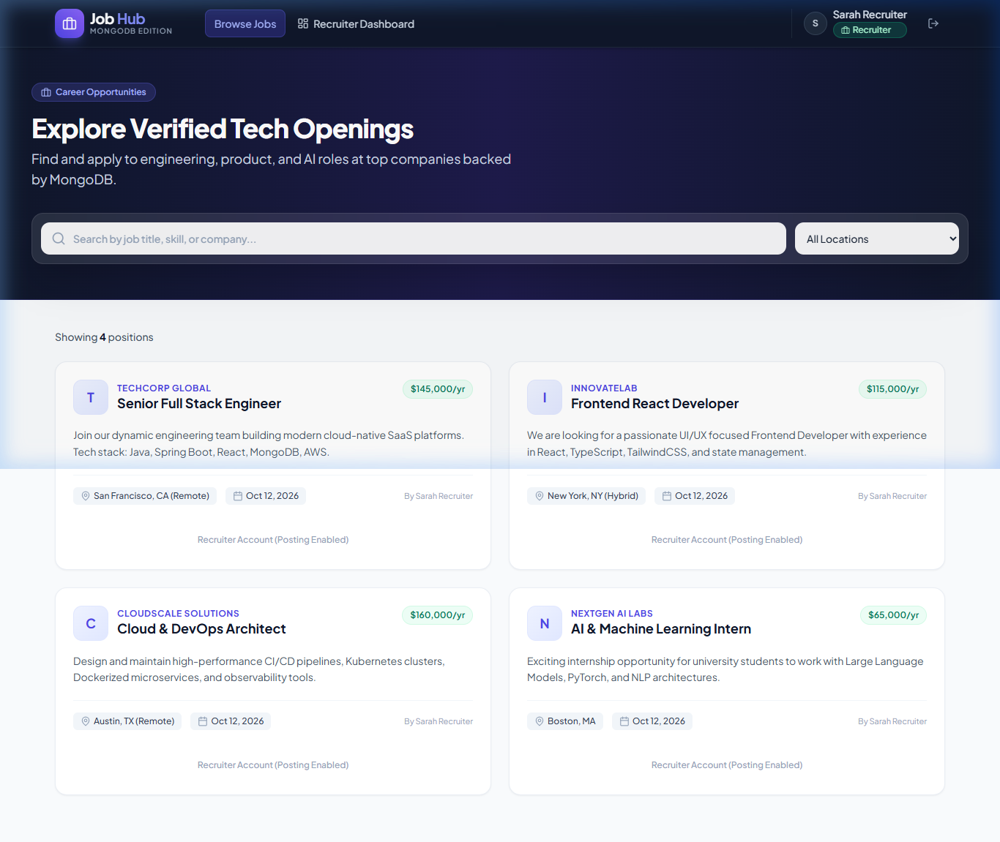
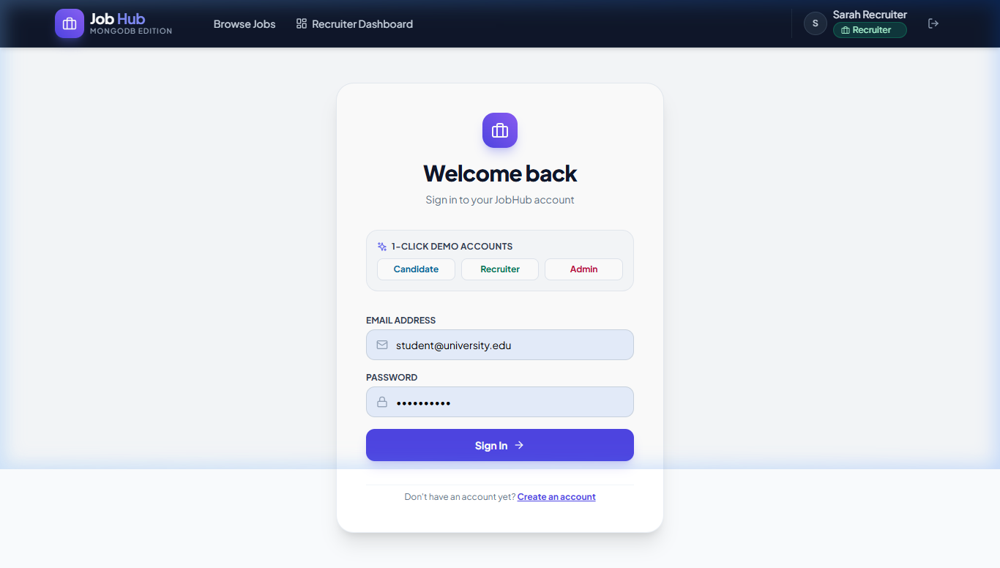
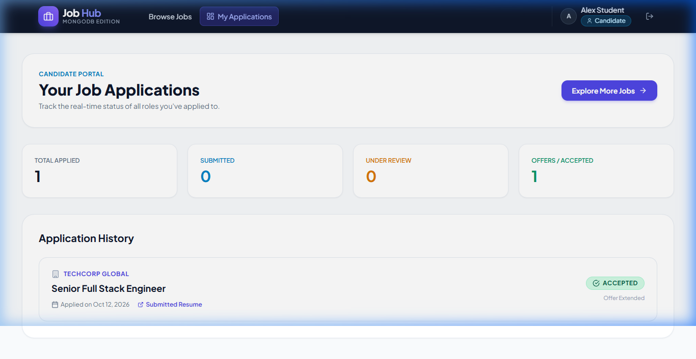
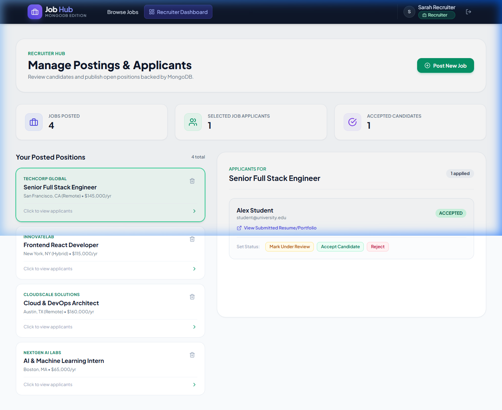
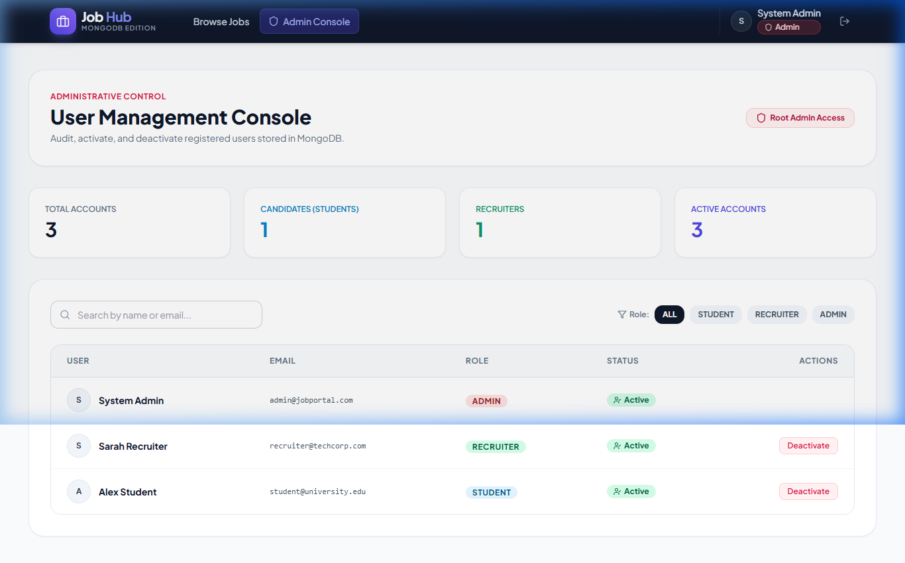

# JobHub - Full-Stack Job Portal (MongoDB Edition)

A modern, full-stack recruitment and job search web platform built with **Spring Boot 3 (Java 17)**, **Spring Data MongoDB**, **JWT Authentication**, and **React 18 + Vite + TailwindCSS**.

---

## 📸 Application Screenshots

### 1. Landing Page
Modern landing page featuring tech stack badges, value proposition, and quick call-to-actions.


### 2. Job Listings & Live Search
Browse verified openings stored in MongoDB, with real-time keyword and location filtering.


### 3. Authentication & 1-Click Demo Login
Secure sign-in with quick buttons to test Candidate, Recruiter, and Admin roles instantly.


### 4. Candidate Dashboard
Track application statuses in real time (`APPLIED`, `REVIEWED`, `ACCEPTED`, `REJECTED`).


### 5. Recruiter Dashboard
Post new jobs, view applicant portfolios, and update candidate statuses in a side-by-side workspace.


### 6. Admin Management Console
Audit registered users across all roles and toggle account active/inactive status.


---

## 🚀 Key Improvements & Migration Summary

1. **Merged Workspace Structure**:
   - Flattened redundant directory nesting (`JobPortal/JobPortal/` → `JobPortal/`).
   - Clean root directory containing `jobportal-backend`, `jobportal-frontend`, and one-click launch scripts (`run-all.bat`, `run-backend.bat`, `run-frontend.bat`).

2. **Complete SQL to MongoDB Migration**:
   - **Removed All SQL/JPA Dependencies & Code**: Removed `spring-boot-starter-data-jpa`, `mysql-connector-j`, `@Entity`, `@Table`, Hibernate dialects, and relational join columns.
   - **Added Spring Data MongoDB**: Configured `spring-boot-starter-data-mongodb` with connection URI `mongodb://localhost:27017/jobportal_db`.
   - **NoSQL Document Models**: Converted `User`, `Job`, and `Application` into MongoDB `@Document` models with standard hexadecimal `String id` identifiers.
   - **MongoRepository Interfaces**: Replaced `JpaRepository` with `MongoRepository` across all repositories.

3. **Debugging & Environment Fixes**:
   - Corrected user environment `JAVA_HOME` which was previously pointing to an invalid `.msi` installer path instead of `C:\Program Files\Java\jdk-17`.
   - Configured `mvnw.cmd` wrapper to use Java 17 and local Apache Maven 3.9.12 without external network dependency issues.
   - Fixed CORS configuration in Spring Security using modern `CorsConfigurationSource`.
   - Permitted public GET access to `/api/jobs/**` so candidates and visitors can view jobs and search without forced authentication.
   - Added robust `GlobalExceptionHandler` handling `BadCredentialsException` (401) and `AccessDeniedException` (403).

4. **Improvisations & New Features**:
   - **Automatic Data Initializer (`DataInitializer.java`)**: Pre-populates sample test accounts (Admin, Recruiter, Student) and sample jobs on initial launch.
   - **Job Search & Filters**: Instant search by keyword, title, company, or location.
   - **Recruiter Dashboard**: Analytics metrics, applicant review workflow (Review, Accept, Reject), and new `/api/jobs/my-jobs` endpoint.
   - **Student Dashboard**: Real-time status cards tracking submitted applications.
   - **Admin Console**: Account metrics and user activation/deactivation toggles.
   - **Quick Demo 1-Click Login**: Buttons on the login page for effortless evaluation.

---

## 🔑 Demo Test Accounts

The database is automatically pre-seeded with these test credentials on startup:

| Role | Email | Password | Access Capabilities |
| :--- | :--- | :--- | :--- |
| **Candidate (Student)** | `student@university.edu` | `student123` | Browse jobs, submit applications with resume URL, track status |
| **Recruiter** | `recruiter@techcorp.com` | `recruiter123` | Post new jobs, view applicants, accept or reject candidates |
| **Administrator** | `admin@jobportal.com` | `admin123` | Audit all accounts, toggle active/inactive status |

---

## 🛠️ How to Run

### Method 1: One-Click Launch (Recommended)
Double-click `run-all.bat` in the project root folder. It will launch both the backend and frontend in separate command windows.

### Method 2: Manual Terminal Execution

#### 1. Backend (Spring Boot + MongoDB)
Ensure your MongoDB service is running on `localhost:27017`.
```bash
cd jobportal-backend
.\mvnw.cmd spring-boot:run
```
Backend runs at: **`http://localhost:8080`**

#### 2. Frontend (React + Vite)
```bash
cd jobportal-frontend
npm run dev
```
Frontend runs at: **`http://localhost:5173`**

---

## 📡 REST API Summary

### Authentication (`/api/auth`)
- `POST /api/auth/register` - Create candidate or recruiter account
- `POST /api/auth/login` - Authenticate with email and password, returns JWT token

### Jobs (`/api/jobs`)
- `GET /api/jobs` - List all active jobs (Public)
- `GET /api/jobs/search?keyword=...` - Search jobs by keyword (Public)
- `GET /api/jobs/{id}` - Get job details by ID (Public)
- `GET /api/jobs/my-jobs` - Get jobs posted by the logged-in recruiter (Recruiter only)
- `POST /api/jobs` - Create a new job posting (Recruiter only)
- `PUT /api/jobs/{id}` - Update job posting (Recruiter only)
- `DELETE /api/jobs/{id}` - Delete job posting and cascade delete applications

### Applications (`/api/applications`)
- `POST /api/applications?jobId=...&resumeUrl=...` - Submit application (Candidate only)
- `GET /api/applications/my-applications` - Get current candidate's applications (Candidate only)
- `GET /api/applications/job/{jobId}` - Get all applications for a specific job (Recruiter/Admin)
- `PUT /api/applications/{id}/status?status=...` - Update application status (`APPLIED`, `REVIEWED`, `ACCEPTED`, `REJECTED`)

### Admin Console (`/api/admin`)
- `GET /api/admin/users` - View all registered accounts (Admin only)
- `PUT /api/admin/users/{id}/deactivate` - Deactivate user (Admin only)
- `PUT /api/admin/users/{id}/activate` - Reactivate user (Admin only)
